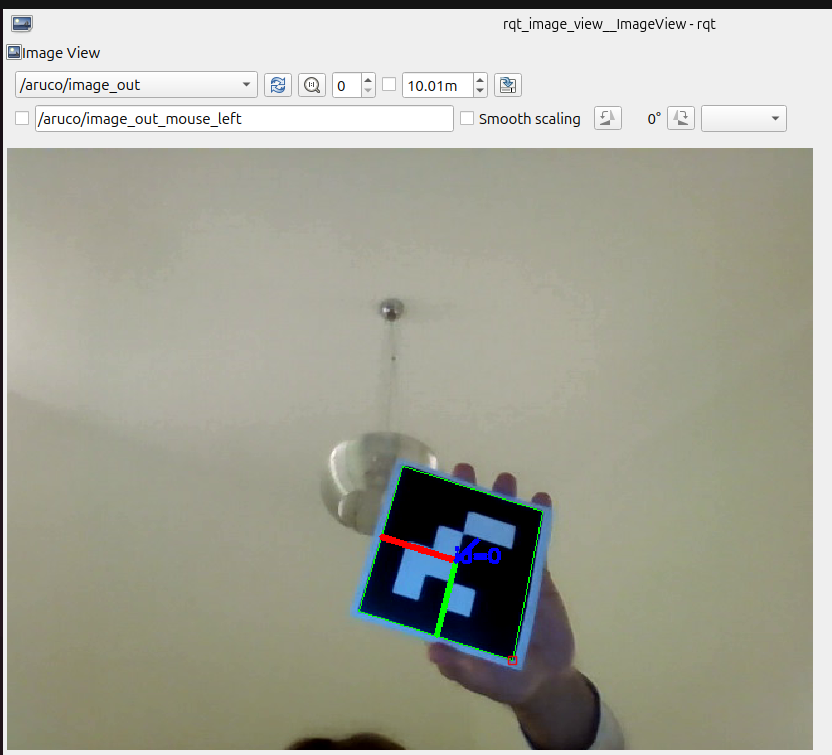
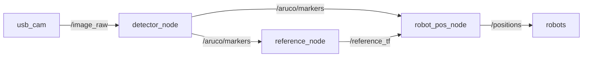

# ROS 2 ArUco Multi-Robot Localization

Real-time 2D localization of multiple mobile robots with an overhead camera, using **ROS 2 Jazzy**, **OpenCV** and ArUco fiducial markers.
Developed as part of my Bachelor's Thesis (TFG) at the Budapest University of Technology and Economics (BME), in weekly iterations agreed with my supervisor.



## Overview

A camera mounted on the ceiling looks down at the floor. A large **reference marker** fixed to the floor defines the ground frame, and each robot carries a small marker on top. The system computes every robot's **position (x, y) and heading** on the floor and publishes them so they can be sent back to the robots.

Because all poses are expressed relative to the reference marker, the result does not depend on the camera's position or tilt.

## Architecture



| Node | Role |
|------|------|
| `detector_node` | Detects ArUco markers and estimates the 3D pose of each one relative to the camera (marker size depends on its ID) |
| `reference_node` | Selects the floor reference marker (ID 1), which defines the ground plane, and keeps its last known pose to tolerate brief occlusions |
| `robot_pos_node` | Expresses every robot marker in the ground frame and publishes its 2D pose |

## ROS interface

| Topic | Message type | Content |
|-------|--------------|---------|
| `/image_raw` | `sensor_msgs/Image` | Camera feed |
| `/aruco/image_out` | `sensor_msgs/Image` | Feed annotated with marker IDs and 3D axes |
| `/aruco/markers` | `aruco_interfaces/MarkerArray` | ID, translation and rotation vector of every detected marker (camera frame) |
| `/reference_tf` | `aruco_interfaces/Marker` | Pose of the reference marker (ground frame origin) |
| `/positions` | `aruco_interfaces/RobotPose2DArray` | ID, x, y (m) and heading (rad) of every robot in the ground frame |

Custom messages live in the separate `aruco_interfaces` package so that any other component (robots, microcontrollers) can use them without depending on the perception code.

## How the 2D pose is computed

Rotations are handled as rotation matrices (no quaternions):

- **Position:** `p = R_refᵀ · (t_robot − t_ref)`. The vector from the reference to the robot, expressed in the ground frame; x and y are kept.
- **Heading:** the robot marker's X axis is expressed in the ground frame and its angle is `atan2(y, x)`.

## Markers

| ID | Role | Size |
|----|------|------|
| 1 | Floor reference | 195 mm |
| 0, 2, 3 | Robots | 100 mm |

Custom dictionary: `generateCustomDictionary(10, 4, 0)`. Marker sizes and the reference ID are ROS parameters.

## Tech stack

C++17 · ROS 2 Jazzy · OpenCV 4.6 (aruco module) · cv_bridge · Ubuntu 24.04

## Build and run

```bash
cd ~/ros2_ws
colcon build --packages-select aruco_interfaces aruco_perception
source install/setup.bash

ros2 run usb_cam usb_cam_node_exe --ros-args -p pixel_format:=mjpeg2rgb
ros2 run aruco_perception detector_node
ros2 run aruco_perception reference_node
ros2 run aruco_perception robot_pos_node

ros2 topic echo /positions
```

(Each `ros2 run` in its own terminal.)

## Progress log

| Week | Focus | Log |
|------|-------|-----|
| 1 | Environment setup, camera pipeline, first detection attempts | [Week 1](docs/weeks/week-01.md) |
| 2 | Custom dictionary, 3D pose estimation, TF2 integration | [Week 2](docs/weeks/week-02.md) |
| 3 | Multi-robot 2D localization architecture | [Week 3](docs/weeks/week-03.md) |

## Known limitations and next steps

- **Camera intrinsics are placeholders**, so absolute values are approximate. Next: calibrate the real camera.
- The reference pose comes from a single detection. Next: filter it over several frames to reduce noise.
- A single camera cannot see robots that are occluded. Possible extension: multiple overhead cameras.
- Next: a launch file to start the whole system with one command.
- Next: micro-ROS on an ESP32 to bring the robot side into ROS 2.
- Final goal: deploy the system on a Raspberry Pi with the camera.
